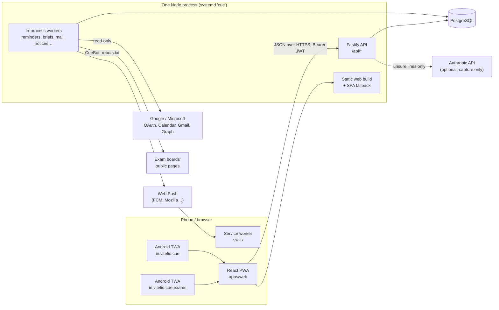
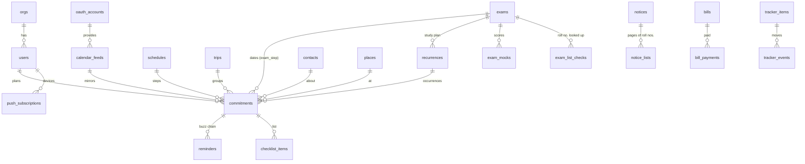
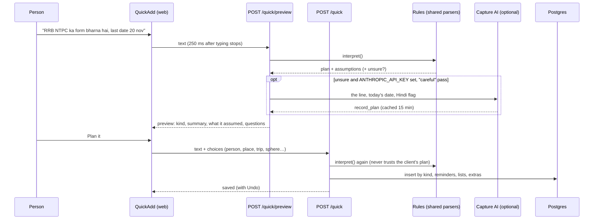
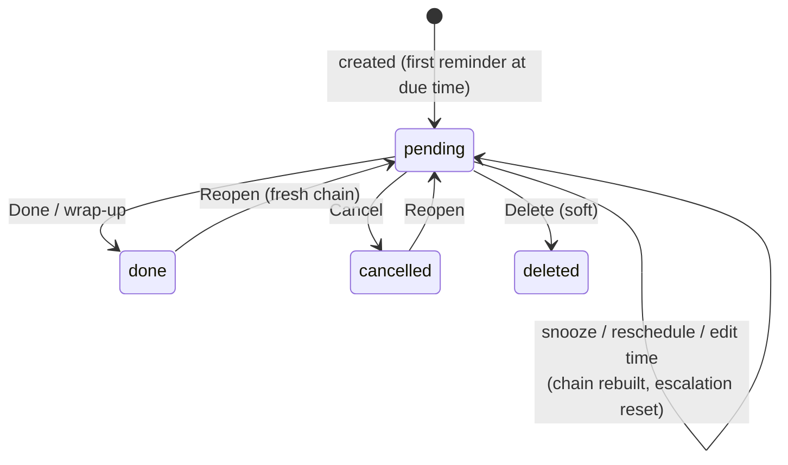
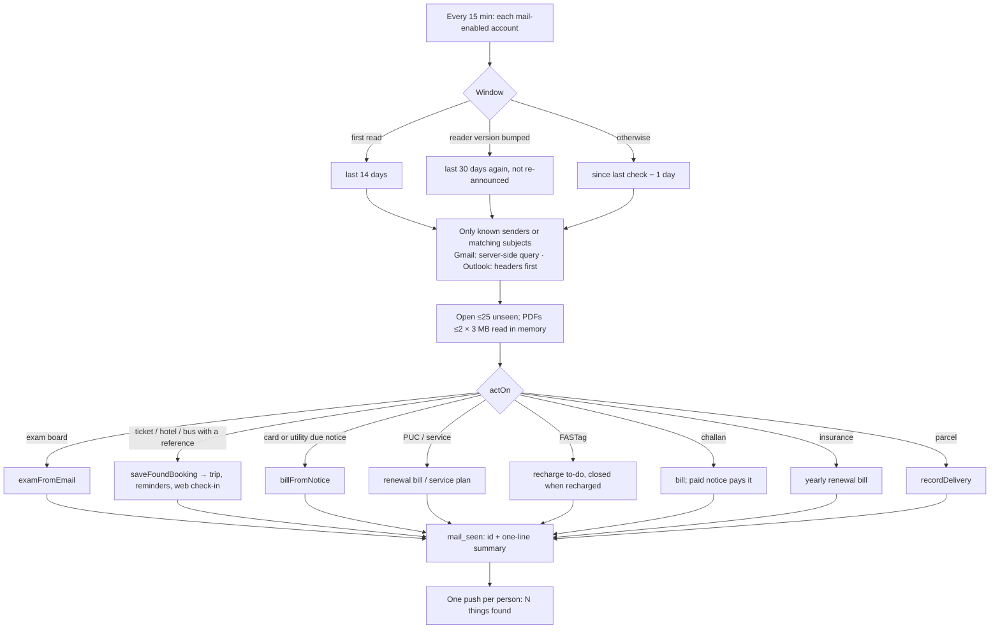
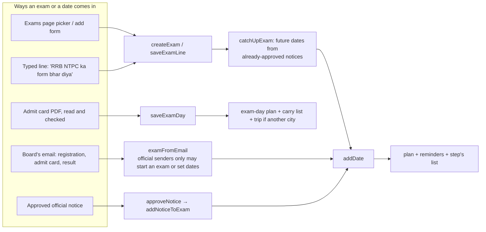
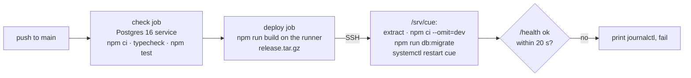

# Cue — developer guide

Everything a developer needs to work on Cue: what it does, how it is built,
how each feature flows from the screen to the database and back, and how it
is tested and shipped. It is written against the code as of 14 Oct 2026
(exams phases E1–E15, migration `0058`). File links are relative to this
folder, so they work on GitHub and in an editor.

> **Contents**
> 1. [What Cue is](#1-what-cue-is)
> 2. [Architecture at a glance](#2-architecture-at-a-glance)
> 3. [Running it locally](#3-running-it-locally)
> 4. [Configuration](#4-configuration)
> 5. [House rules](#5-house-rules)
> 6. [The server](#6-the-server)
> 7. [Data model](#7-data-model)
> 8. [Core flows](#8-core-flows)
> 9. [The exams module](#9-the-exams-module)
> 10. [The web client](#10-the-web-client)
> 11. [Languages: English and Hindi](#11-languages-english-and-hindi)
> 12. [Push notifications](#12-push-notifications)
> 13. [Android apps](#13-android-apps)
> 14. [Testing](#14-testing)
> 15. [Database migrations](#15-database-migrations)
> 16. [CI, deploy and production](#16-ci-deploy-and-production)
> 17. [Security and privacy, as enforced in code](#17-security-and-privacy-as-enforced-in-code)
> 18. [Recipes](#18-recipes)
> 19. [Known gaps and loose ends](#19-known-gaps-and-loose-ends)

---

## 1. What Cue is

Cue is a personal assistant for anyone with a lot to remember: say a thing
once — typed, dictated, shared from another app, or found in your email —
and Cue turns it into a plan with the right reminders, and keeps at you
until it is done. It is built for India first: Hinglish and Hindi lines are
understood, the whole app is in English and Hindi, rupees, UPI, IRCTC,
FASTag, PUC and the exam boards are all known.

It is generic on purpose. What a person picks they use Cue for (personal
life, office work, sales, hiring, freelance, a job search, studies,
competitive exams) only decides which sections they see first; every
feature is open to everyone.

**Two apps, one codebase.**

| | Cue | Cue Exams |
|---|---|---|
| Who | Everyone | Aspirants for government and entrance exams |
| Web | `https://cue.vitelio.in/` | `https://cue.vitelio.in/exams?app=exams` |
| Android (TWA) | `in.vitelio.cue` | `in.vitelio.cue.exams` |
| Lands on | Today | Exams, Hindi first |

Cue Exams is the same web app in "exams mode" (see
[§10.8](#108-cue-exams-mode)), not a separate build.

**What it does, by area**

- **Capture** — one box understands plain sentences in English, Hinglish
  and Hindi: plans, repeating plans, trips, wishes ("when I'm in Pune…"),
  bills, expenses, money owed, parcels, bookings, exam lines, job/hiring/deal
  updates. An optional AI reading helps only with lines the rules are unsure
  of.
- **Plans and nagging** — every plan gets reminders that escalate until it
  is done, snoozed or moved; overdue items are triaged, moved into real free
  slots, or let go.
- **The day's rhythm** — morning brief, meeting prep, after-meeting
  follow-ups, focus blocks, an evening nudge that plans tomorrow, a daily
  report for whoever you report to, a Friday weekly review, and for
  aspirants a Sunday prep report.
- **Your inbox and calendar, read for you** — Gmail/Outlook (read-only)
  give tickets, hotel stays, parcels, bills, insurance, PUC, service dates,
  FASTag, challans and exam emails; Google/Microsoft calendars and ICS feeds
  are mirrored.
- **Trips** — assembled from bookings and plans in other cities, with
  packing lists and "while I'm there" wishes.
- **People** — contacts, keep-in-touch cadences, birthdays and greetings,
  who you are waiting on, money owed with UPI reminders.
- **Work** — job hunt, hiring and deal boards; companies and their stages;
  weekly targets.
- **Money** — bills and renewals, expenses and claims, parcels with cash on
  delivery.
- **Exams** — every exam applied for with its dates from the boards'
  official notices, admit cards read, results looked up, study plans, mock
  scores, expected scores, clashes, and ready-made lists for each step.

**Two demos, no sign-up.** "Try the demo" on the website opens a 24-hour
account with a sample week; "Try the Cue Exams demo" (on the website's exams
section and on the Cue Exams home) opens an aspirant's account with every
exams feature already in use ([§9.11](#911-the-exams-demo)). Both open in
the language the visitor was reading.

---

## 2. Architecture at a glance



**Monorepo** (npm workspaces, Node ≥ 22, ES modules, TypeScript everywhere):

| Path | What it is |
|---|---|
| [`apps/api`](../apps/api) | Fastify 5 API, run as TypeScript through `tsx` (no build step). Drizzle ORM over postgres.js. Hand-written SQL migrations. |
| [`apps/web`](../apps/web) | React 18 + react-router 7 + Vite 6 PWA (vite-plugin-pwa, `injectManifest`). One global stylesheet. |
| [`packages/shared`](../packages/shared) | `@cue/shared`: zod input schemas, DTO types, and all the pure logic both sides need — the sentence parsers, recurrence rules, the exam catalog, notice readers, Hindi tables. Consumed as TS source. |
| [`android`](../android) | Bubblewrap TWA definitions and Play Store listings for both apps. |
| [`scripts`](../scripts) | `setup-db.ps1` (Windows local Postgres). |
| [`.github/workflows`](../.github/workflows) | `deploy.yml` (check + deploy), `android.yml` (build an app). |

**Why it is shaped this way**

- *One process, one port, one URL.* The API serves the built web app, so
  production is a single systemd unit behind Caddy; the same origin means no
  CORS in production and the service worker scope is the whole site.
- *Logic in `shared`.* Parsers and rules are pure functions with unit tests;
  the server calls them to save, the web calls some of them to preview or
  label.
- *Everything is a commitment.* A plan, an exam date, a study session, a
  mirrored calendar event, a booking and a bill reminder all end up as rows
  in `commitments`, so Today, the calendar, search and the reminder engine
  work for all of them without knowing where they came from.

**Tech stack (installed versions)**

| Area | Stack |
|---|---|
| Runtime | Node 22, tsx 4.23, TypeScript 5.9 (strict, `noUncheckedIndexedAccess`) |
| API | fastify 5.12, @fastify/jwt 9, @fastify/cors 10, @fastify/static 8, zod 3.25, bcryptjs, web-push 3.6, nodemailer, pdfjs-dist 6.3 (pinned) |
| DB | PostgreSQL 14+ (CI 16, local 18), postgres.js 3.4, drizzle-orm 0.38 |
| Web | react 18.3, react-router-dom 7, vite 6.4, vite-plugin-pwa 0.21, workbox 7.4 |
| Tests | `node:test` + `node:assert/strict` via `tsx --test`; API tests against real Postgres |

---

## 3. Running it locally

**Prerequisites:** Node 22+, a local PostgreSQL (14 or newer). No Docker.

```bash
npm install
```

1. **Create a database.** On Windows `npm run db:setup` creates the `cue`
   role and database (it asks for the Postgres superuser password). On other
   systems, create a database by hand.
2. **Create `.env` at the repo root** (both the API and Vite read it from
   there). The minimum is `DATABASE_URL` and `JWT_SECRET`; see
   [§4](#4-configuration). **Never point a local `.env` at the production
   database.**
3. **Migrate.** On a brand-new, empty database the first run needs the
   guard lifted once:
   ```bash
   CUE_NEW_DATABASE=1 npm run db:migrate
   ```
   After that, always plain `npm run db:migrate`. (Do not use
   `npm run db:push`: drizzle-kit push is broken against PostgreSQL 18, and
   the migrations folder is the source of truth.)
4. **Run.**
   ```bash
   npm run dev          # API on :3002 (tsx watch) + Vite on :5173
   ```
   Or build the web app and let the API serve it on one port, as in
   production:
   ```bash
   npm run build
   PORT=3002 npm start -w @cue/api
   ```
5. **Optional pieces**
   - Push: `npm run vapid` prints a key pair for `VAPID_PUBLIC_KEY` /
     `VAPID_PRIVATE_KEY`.
   - Google/Microsoft: client id/secret plus `ENCRYPTION_KEY`;
     `npm run check:oauth` prints what the server derives (never secrets).
   - Capture AI: `ANTHROPIC_API_KEY`.
   - Exam notices: `ADMIN_EMAILS` to review them; `NOTICE_WATCH=off` to stop
     the watcher reading boards' sites from your machine.
   - `npm run seed` creates a local demo tenant; or press "Try the demo" on
     the website, which makes a 24-hour demo account with a sample week.

**A throwaway database for tests.** API tests create and drop their own
schemas, but they still need a database to do it in. The simplest safe set-up
is a private cluster on its own port with trust auth:

```bash
initdb -D <scratch>/pgdata -U postgres --auth=trust
pg_ctl -D <scratch>/pgdata -o "-p 5499 -c listen_addresses=localhost" -l <scratch>/pg.log start
createdb -h localhost -p 5499 -U postgres cue
DATABASE_URL=postgres://postgres@localhost:5499/cue npm run db:migrate   # with CUE_NEW_DATABASE=1 the first time
DATABASE_URL=postgres://postgres@localhost:5499/cue npm run test:api
```

---

## 4. Configuration

All server configuration is environment variables, read once in
[`apps/api/src/env.ts`](../apps/api/src/env.ts) from the repo-root `.env`.

| Variable | Default | Purpose |
|---|---|---|
| `DATABASE_URL` | **required** | Postgres URL (`?sslmode=require` for managed hosts) |
| `JWT_SECRET` | **required** | Signs session tokens |
| `PORT` / `HOST` | `3002` / `0.0.0.0` | Listen address; use `HOST=127.0.0.1` behind a proxy |
| `WEB_ORIGIN` | `http://localhost:5173` | CORS origin, base for reset links and OAuth returns |
| `APP_TIMEZONE` | `Asia/Kolkata` | Sets `process.TZ` for the whole server (day boundaries) |
| `VAPID_PUBLIC_KEY`, `VAPID_PRIVATE_KEY`, `VAPID_SUBJECT` | empty | Web push |
| `ENCRYPTION_KEY` | empty | AES-256-GCM for OAuth tokens, ICS URLs and own-key AI keys. Without it, Google/Microsoft count as not configured |
| `GOOGLE_CLIENT_ID`, `GOOGLE_CLIENT_SECRET`, `GOOGLE_REDIRECT_URI` | empty / derived | Google Calendar and Gmail |
| `MICROSOFT_CLIENT_ID`, `MICROSOFT_CLIENT_SECRET`, `MICROSOFT_TENANT`, `MICROSOFT_REDIRECT_URI` | empty / `common` / derived | Outlook calendar and mail |
| `PLACE_LOOKUP_PROVIDER`, `GOOGLE_PLACES_API_KEY` | `auto` / empty | Businesses near a point: Google if a key, else OpenStreetMap |
| `SMTP_HOST`, `SMTP_PORT`, `SMTP_USER`, `SMTP_PASSWORD`, `SMTP_FROM` | empty / 587 | Password-reset email only |
| `ANTHROPIC_API_KEY`, `CAPTURE_AI_MODEL` | empty / `claude-haiku-5-5` | Capture AI; empty means rules only |
| `CAPTURE_AI_DAILY_LIMIT`, `CAPTURE_AI_DEMO_LIMIT` | 40 / 8 | AI readings per user per day |
| `AI_DEFAULT_MODEL` | `claude-haiku-5-5` | An org's own-key extraction |
| `ADMIN_EMAILS` | empty | Comma-separated; who reviews exam notices. **Nothing from the boards reaches anyone until this is set and notices are approved.** |
| `NOTICE_WATCH` | `on` | `off` stops the exam-board watcher |
| `ANDROID_PACKAGE`, `ANDROID_CERT_SHA256` | `in.vitelio.cue` / none | Digital Asset Links for the Cue app |
| `ANDROID_EXAMS_PACKAGE`, `ANDROID_EXAMS_CERT_SHA256` | `in.vitelio.cue.exams` / none | …and for Cue Exams |
| `TRAVEL_SPEED_KMH` | 45 | Travel-time estimates between places |
| `REMINDER_POLL_MS`, `ESCALATION_MINUTES`, `MAX_ESCALATIONS` | 20000 / 15 / 4 | The nag engine |
| `CUE_NEW_DATABASE` | unset | `1` only for the very first migrate of an empty database |

**Web build-time:** `VITE_API_URL` (leave **blank in production** so the
browser calls its own origin), `WEB_PORT` (Vite dev port, 5173).

---

## 5. House rules

These are decisions, not accidents. Keep them.

1. **Every user-visible string has Hindi.** Web text goes through `t()`,
   `msg()` or `rich()` with an entry in `apps/web/src/lib/hi/*.ts`; server
   text through `t(lang, …)` with an entry in `apps/api/src/hi/*.ts`; exam
   screens through `examWords`. Tests fail otherwise
   ([§11](#11-languages-english-and-hindi)). Policies are kept in pairs.
2. **Email is never sent to any AI service.** The privacy policy promises
   it. The mail path has no AI call; keep it that way.
3. **Exams: no portal logins, ever.** Cue never signs in to an exam or SSO
   portal, never asks for a portal password, an OTP or a date of birth, and
   never spoofs a browser to get past a bot refusal. It reads boards' public
   pages as `CueBot`, obeys robots.txt, and accepts a WAF's "no".
4. **Nothing from a board reaches a person without a human.** Notices are
   proposed by code and approved by a reviewer (`ADMIN_EMAILS`).
5. **Sections appear because they are wanted.** The defaults are People,
   Trips, Repeating and History; anything else shows because the person
   picked a use that leads to it or already has something in it
   ([§8.12](#812-sections-who-sees-what)).
6. **Migrations are hand-written SQL, forward-only and idempotent.**
   `schema.ts` is kept in step by hand. The migrate script refuses a
   database with no history unless told it is new.
7. **Tests run against a real Postgres.** Never against production.
8. **Comments explain why, in plain words.** The code base reads like a
   description of the product; match it.

---

## 6. The server

### 6.1 Bootstrap

[`apps/api/src/index.ts`](../apps/api/src/index.ts):

1. Fastify with pino logging at `info`. A `ZodError` becomes
   `400 {error:'invalid_input', issues}`; other errors become
   `{error: message}` with their status (≥500 logged).
2. CORS for `WEB_ORIGIN`; JWT auth (`registerAuth`); static serving of
   `apps/web/dist` with an SPA fallback (404 JSON for `/api*` and non-GET).
3. Unprefixed: `GET /health` → `{ok, push}` (does not touch the DB);
   `GET /.well-known/assetlinks.json` (built from the `ANDROID_*` variables);
   `POST /share-file` fallback for the Cue Exams share target.
4. Every route module registered under `/api` (36 files,
   [§6.3](#63-route-catalogue)).
5. Start-up checks: `select 1`, the time zone, OAuth redirect sanity, VAPID
   presence.
6. Starts the workers ([§6.4](#64-background-workers)); on SIGINT/SIGTERM
   stops them and closes Fastify.

### 6.2 Auth and tenancy

- **Sessions** are JWTs (`@fastify/jwt`, 30 days) with
  `{sub: userId, orgId, email}`. `app.authenticate` guards routes;
  `scope(req)` returns the claims. **Tenant ids come from the token, never
  from a request body**, and every query filters by them.
- **Sign-up** creates an org (`"<name>'s account"`) and the user as
  `owner`. bcrypt cost 10. Login failures are a single
  `invalid_credentials`.
- **Password reset**: a 32-byte token stored as a SHA-256 hash, single use,
  one hour; `/auth/forgot` answers the same whether or not the address
  exists.
- **Demo accounts**: `POST /auth/demo {kind?: 'everyday'|'exams',
  language?: 'en'|'hi'}` makes org "Demo" with user "Asha" — a sample week
  (`sampleDay.ts`), or an aspirant's account (`examsDemo.ts`) — in that
  language from the start; 5 per address per hour, 120 per hour overall;
  deleted after 24 hours. Demos cannot connect Google/Microsoft and get a
  smaller AI allowance.
- **Admins** are the addresses in `ADMIN_EMAILS`. `/api/auth/me` returns
  `isAdmin`; `/api/admin/notices*` answer 404 to anyone else.
- **Account deletion** needs the password (not for demos), revokes OAuth
  grants first, then deletes the user — or the whole org if they were alone.

### 6.3 Route catalogue

All under `/api`, all authenticated unless noted. Files are in
[`apps/api/src/routes`](../apps/api/src/routes).

| File | Endpoints | For |
|---|---|---|
| `auth.ts` | `POST /auth/register`, `/login`, `/demo`, `/forgot`, `/reset`, `/change-password`; `GET/DELETE /auth/me`; avatar `POST/DELETE /auth/avatar`, `GET /auth/avatar/:id`; `PATCH /auth/profile` | Accounts |
| `me.ts` | `GET /me/filled`; `GET/PATCH /me/preferences`; `POST /me/preferences/test-brief`, `test-nudge`, `test-report`, `test-exam-week` | Preferences, sections with something in them, "send it now" |
| `quickAdd.ts` | `GET /quick/suggestions`; `POST /quick/preview`; `POST /quick`; `DELETE /quick/:kind/:id` | The capture box ([§8.1](#81-capture-the-one-box)) |
| `commitments.ts` | `GET /commitments/range`, `/agenda`, `/queue`; `POST /commitments`, `/check-conflicts`, `/suggest-slots`; `GET/PATCH/DELETE /commitments/:id`; `POST /:id/done`, `/cancel`, `/snooze`, `/reschedule`, `/wrap-up`; `GET /:id/slots`, `/:id/prep`; `GET /people/summary`, `/people/:id/overview`, `/accounts/overview` | Plans |
| `checklist.ts` | `GET/POST /commitments/:id/checklist`; `PATCH/DELETE /checklist/:itemId` | Lists on plans |
| `recurrences.ts` | `GET/POST /recurrences`; `GET/PATCH/DELETE /recurrences/:id`; `POST /recurrences/:id/detach/:commitmentId` | Repeating plans |
| `schedules.ts` | `GET/POST /schedules`; `DELETE /schedules/:id` | Step schedules (e.g. child vaccinations) |
| `focus.ts` | `POST /focus`; `POST /focus/:id/end` | Focus blocks |
| `insights.ts` | `GET /insights`; `POST/DELETE /sample-day`; `GET/POST /plan/tomorrow`; `GET/POST /triage` | Today's insights, planning tomorrow, triage |
| `review.ts` | `GET /review/week`; `POST /review/week/done`, `/test` | Weekly review |
| `report.ts` | `GET /report/day` | Daily report / stand-up |
| `availability.ts` | `GET /availability` | Free times to send someone |
| `search.ts` | `GET /search`, `/history`, `/people/match`; `DELETE /history/:kind/:id` | Search and history |
| `trips.ts` | `GET/POST /trips`; `GET/PATCH/DELETE /trips/:id`; `POST /trips/:id/packing` | Trips |
| `intentions.ts` | `GET/POST /intentions`, `POST /intentions/batch`, `/nearby`; `PATCH/DELETE /intentions/:id`; `POST /intentions/:id/schedule`; `POST /commitments/:id/attach-wishes`; `POST /trips/:id/plan-wishes` | Wishes ("while I'm there") |
| `places.ts` | `GET/POST /places`; `POST /places/lookup`, `/match`; `GET /places/:id`, `/places/:id/suggestion` | Places |
| `visits.ts` | `POST/GET /visits`; `GET/PATCH/DELETE /visits/:id` | Logged visits (offline-safe by `clientId`) |
| `voiceNotes.ts` | `POST/GET /voice-notes`; `GET /voice-notes/:id/audio`; `PATCH/DELETE /voice-notes/:id` | Voice notes |
| `calls.ts` | `POST /calls` | A call just made, and what came of it |
| `contacts.ts` | `GET/POST /contacts`, `GET /contacts/organizations`, `POST /contacts/import`; `GET/PATCH/DELETE /contacts/:id`; `POST /contacts/:id/touched`, `/touch-later`; `GET /people/keep-in-touch` | People |
| `occasions.ts` | `GET /occasions/upcoming`; `GET/POST /greetings`; `GET /greetings/:id`; `POST /greetings/:id/sent` | Birthdays, festival greetings |
| `owed.ts` | `GET/POST /owed`; `POST /owed/status`, `/owed/asked`; `DELETE /owed/:id`; `PUT /expenses/:id/shares` | Money owed to you |
| `templates.ts` | `GET/POST /templates`; `POST /templates/starters`; `PATCH/DELETE /templates/:id`; `POST /templates/:id/used` | Quick messages |
| `accounts.ts` | `GET/PUT /accounts`; `POST /accounts/rename` | Companies and their stages |
| `trackers.ts` | `GET /trackers`; `GET/POST /trackers/:board`; `GET/PATCH/DELETE /tracker-items/:id` | Jobs, hiring, deals boards |
| `targets.ts` | `GET /targets/week`; `PUT /targets` | Weekly targets |
| `expenses.ts` | `GET /expenses`, `/unclaimed`, `/claimed`; `POST /expenses`, `/claim`; `PATCH/DELETE /expenses/:id`; receipt `GET/POST/DELETE /expenses/:id/receipt` | Expenses and claims |
| `bills.ts` | `GET/POST /bills`; `PATCH/DELETE /bills/:id`; `POST /bills/:id/paid`, `/undo-paid`; `GET /bills/:id/payments` | Bills and renewals |
| `deliveries.ts` | `GET /deliveries`; `PATCH/DELETE /deliveries/:id` | Parcels |
| `calendarFeeds.ts` | `GET/POST /calendar-feeds`; `POST /calendar-feeds/upload`; `POST /calendar-feeds/:id/sync`; `PATCH/DELETE /calendar-feeds/:id` | Calendars Cue reads |
| `oauth.ts` | `GET /oauth/status`; `POST /oauth/:provider/connect`; `GET /oauth/:provider/callback` (no auth); `GET/POST /oauth/accounts/:id/calendars`; `POST /oauth/accounts/:id/setup`; `DELETE /oauth/accounts/:id` | Google / Microsoft |
| `mail.ts` | `GET /mail/found`; `POST /mail/check`; `POST /oauth/accounts/:id/mail-off` | Mail reading |
| `push.ts` | `GET /push/public-key` (no auth); `POST /push/subscribe`, `/unsubscribe`, `/test` | Web push |
| `ai.ts` | `GET/PATCH /ai/settings`; `POST /ai/ollama-models`, `/ai/test`, `/ai/extract` | An org's own AI key (owner only) |
| `exams.ts` | 18 routes under `/exams` | [§9](#9-the-exams-module) |
| `notices.ts` | 6 routes under `/admin/notices` (admins only) | [§9.4](#94-official-notices-the-watcher-and-the-reviewer) |

### 6.4 Background workers

All run inside the API process. Each runs once at start, then on its
interval, with a guard so ticks never overlap. Per-user schedules are judged
in the **user's** time zone (`users.timezone`), and each records the local
date it last sent, so a restart cannot send twice.

| Worker | File | Every | Does |
|---|---|---|---|
| Reminders | [`worker/reminders.ts`](../apps/api/src/worker/reminders.ts) | 20 s | Claims due reminders (`FOR UPDATE SKIP LOCKED`), pushes, escalates ([§8.2](#82-plans-reminders-and-the-nag-engine)) |
| Morning brief | `services/morningBrief.ts` | 5 min | At `morningBriefHour` (8): today's shape; nothing on an empty day |
| Evening nudge | `services/dailyNudge.ts` | 5 min | At `dailyNudgeHour` (19): "did you log everything?", and tomorrow planned |
| Daily report | `services/dailyReport.ts` | 5 min | Opt-in, at `reportHour` (18): "your report is ready" |
| Weekly review | `services/weeklyReview.ts` | 10 min | Friday at `weeklyReviewHour` (17) |
| Sunday prep report | `services/examWeek.ts` | 10 min | Sunday 18:00–21:00 for anyone with an open exam |
| Meeting prep | `services/meetingPrep.ts` | 2 min | 15 min before a meeting with things open from last time |
| Follow-ups | `services/wrapUp.ts` | 2 min | A one-off meeting that just ended: "anything to follow up?" |
| Focus | `services/focus.ts` | 2 min | Closes finished focus blocks (no push) |
| Bills | `services/bills.ts` | 15 min | Days before, on the day, the day after (09:00–21:00 local) |
| Deliveries | `services/deliveries.ts` | 15 min | "Arriving today", with cash on delivery |
| Mail | `services/mailReader.ts` | 15 min | Reads connected mailboxes ([§8.5](#85-reading-email)) |
| Exam notices | `services/noticeWatch.ts` | 2 min after start, then 12 h | Reads exam boards' pages ([§9.4](#94-official-notices-the-watcher-and-the-reviewer)); `NOTICE_WATCH=off` stops it |
| Demo clean-up | `services/demo.ts` | 1 h | Deletes demo orgs older than 24 h |
| Recurrence sweep | `services/recurrence.ts` | 1 h | Keeps 120 days of repeating plans written ahead |
| Calendar sync | `services/calendarFeed.ts` | 30 min | Re-reads ICS, Google and Microsoft calendars |
| Voice-note purge | `routes/voiceNotes.ts` | 1 h | Removes audio never attached to a visit |

---

## 7. Data model

The types live in [`apps/api/src/db/schema.ts`](../apps/api/src/db/schema.ts)
(Drizzle); the truth is the SQL in
[`apps/api/migrations`](../apps/api/migrations). 37 tables.



| Group | Tables |
|---|---|
| Accounts | `orgs` (tenant; own-key AI settings), `users` (credentials, role, timezone, language, notification preferences and last-sent dates, uses, home city, UPI id, exam preferences, `is_demo`), `password_resets`, `oauth_states`, `oauth_accounts` (encrypted tokens, mail on/off), `push_subscriptions` |
| Plans | `commitments` (the core: kind `callback/meeting/task/followup/focus`, status `pending/done/cancelled/deleted`, `due_at`, duration, `flexibility`, priority, `waiting_on`, `booking` jsonb, `sphere`, links to contact/place/trip/feed/recurrence/exam), `reminders` (`fire_at`, `status`, `attempt`, `held`), `checklist_items`, `recurrences`, `schedules`, `interactions` (visits, calls), `voice_notes` |
| Calendars and mail | `calendar_feeds` (ICS URL, upload, Google or Microsoft calendar), `mail_seen` (message ids read and a one-line summary of what was found — never the content) |
| People | `contacts` (phone, organization, birthday/anniversary `MM-DD`, keep-in-touch), `accounts` (a company's stage and notes, matched by name), `message_templates`, `greeting_runs`, `greeting_sends`, `money_owed` |
| Places and trips | `places` (lat/lng/radius), `trips`, `intentions` (wishes), `geocode_cache` |
| Money | `bills`, `bill_payments`, `expenses` (paise; receipts as bytea), `deliveries` |
| Work | `tracker_items`, `tracker_events` (jobs, hiring, deals) |
| Exams | `exams`, `exam_mocks`, `notices`, `notice_lists`, `exam_list_checks`, `notice_sources` ([§9.2](#92-data)) |

---

## 8. Core flows

### 8.1 Capture: the one box

Typed or dictated (the browser transcribes; the server only ever sees text)
or shared in from another app. Files:
[`routes/quickAdd.ts`](../apps/api/src/routes/quickAdd.ts),
[`services/captureAi.ts`](../apps/api/src/services/captureAi.ts),
parsers in [`packages/shared/src`](../packages/shared/src).



**`interpret()` tries readers in this order; the first that matches wins:**

1. `parseChecklist` — a colon introduces a list ("pack for Pune: charger,
   tickets").
2. `normalizeHinglish` — Roman and Devanagari time words become English
   (kal, parso, subah, shaam ko, baje…); nothing else changes.
3. `parseDelivery` → **delivery**.
4. `parseExamLine` → **exam** (`saveExamLine`).
5. `parseChallan` → **bill** (vehicle).
6. `parseFastag` (low balance) → a "Recharge FASTag" to-do.
7. `parseVehicleNotice` (PUC) → renewal **bill**.
8. `parseBooking` / a service notice → **commitment with a booking**.
9. `parseWishList` → several **wishes**.
10. `parseInsurance` → yearly **bill**.
11. `parseBill` → **bill** (rent, EMI, passport expiry…).
12. `parseTrackerLine` → **tracker** item (jobs, hiring, deals).
13. `parseOwed` → **money owed**.
14. `parseExpense` (unless it starts "pay/send/book…") → **expense**.
15. A pronoun with no name ("call him") → **ask who**.
16. `parseIntention` → **wish**.
17. `parseTrip` → **trip**.
18. `parseRecurrence` / a birthday or anniversary → **repeating plan** (one
    series per clock time).
19. `parseRelative` ("after standup") → anchored plan, or **ask when**.
20. `extractRoles` (kind, person, place, subject) → plan, or ask who / when.
21. `parseWhen` → a dated plan; with no date, a learned habit hour, an
    appointment question, or a flexible item for today marked unsure.

Then **`enrich()`** links a certain person, place, company or trip (a plan
in another city offers a trip), and **`withSuggestions()`** offers extras:
move after a trip, start early, a prep focus block, book a cab, a yearly
gift reminder. Errors on save: `422` unclear, `428` needs a time, `300`
needs a person, `409` a time clash (the client offers "book it anyway").
`DELETE /quick/:kind/:id` is the Undo.

**Capture AI** ([`captureAi.ts`](../apps/api/src/services/captureAi.ts)) is
used only when the rules are unsure or Hindi is left in the title, and only
with `ANTHROPIC_API_KEY` set. It sends the line, today's date and a Hindi
flag — no names, contacts or account data — with a forced tool
(`record_plan`), an 8 s timeout and a daily cap. What is saved is the
cached reading the person saw.

### 8.2 Plans, reminders and the nag engine



- `scheduleFirstReminder` queues attempt 0 at the due time. The worker
  ([`worker/reminders.ts`](../apps/api/src/worker/reminders.ts)) claims due
  reminders, and for each:
  1. cancels it if the plan is no longer pending;
  2. **focus hold** — during an active focus block, anything not critical is
     re-queued for the block's end (`held`);
  3. **keep apart** — for people with a working life who chose it, a
     nagging personal reminder waits for the end of the work day and a work
     one for the next work day (`services/workLife.ts`); times the person
     chose, and critical items, always ring;
  4. pushes the right words: focus starting, waiting-on check-in, a
     booking's "leaves in 45 min", an exam line, a mirrored event's
     "starting now", or "due now" then "still open — 30 min overdue";
  5. queues the next attempt `ESCALATION_MINUTES` later, up to
     `MAX_ESCALATIONS` buzzes.
- **Never chased:** mirrored calendar events, waiting-on items, focus blocks,
  bookings; exam dates only for the last date to apply or pay.
- **Overdue** (`services/overdue.ts canBeOverdue`) excludes calendar
  history, all-day mirrored events, meetings awaiting their wrap-up (7 days),
  waiting-on, focus and bookings. Chased-out items surface in **Triage**
  (`services/triage.ts`): done, reschedule, someday or drop. **Move it**
  offers three real free slots (`services/freeSlots.ts`).
- **Clashes** (`services/scheduling.ts checkConflicts`) block a save with
  `409` and suggestions unless allowed; location clashes (a plan during a
  trip elsewhere, not enough travel time) warn but never block.

### 8.3 Repeating plans

- Rules ([`shared/recurrence.ts`](../packages/shared/src/recurrence.ts)):
  `freq` daily/weekly/monthly/yearly, `interval`, `byWeekday` (0 =
  Sunday), `byMonthDay`, **`byMonth` (0 = January)**, `setPos` ("second
  Tuesday"), `until`, `count`, `exdates`. `describeRecurrence` words them in
  either language.
- Occurrences are **written ahead** as ordinary commitments
  (`recurrence_id`, `occurrence_on`) for 120 days by `materialise`; a unique
  index makes it idempotent. The hourly `sweep` tops them up. So the nag
  engine, Today and search need to know nothing about recurrence.
- Editing a rule `regenerate`s future untouched occurrences; stopping
  (`stopSeries`) removes them; "just this one" `detach`es an occurrence.
- Repeating shows the next date from written occurrences, or — past the
  120-day window, e.g. a yearly reminder months off — from the rule.

### 8.4 Calendars

- Three sources into `calendar_feeds`: an ICS URL (stored encrypted; SSRF
  guard: https/webcal only, no private addresses, no redirects, 8 MB, 20 s),
  an uploaded `.ics`, or a Google/Microsoft calendar via OAuth.
- `syncFeed` → `reconcile`: one-off events become `meeting` commitments
  keyed by `feed_id + external_uid`; repeating events become recurrences;
  events that vanished are removed only if future, pending and untouched.
  Window: `historyDays` back (365) to 400 days ahead.
- Mirrored events are **read-only** and never written back, announced once
  ("starting now") only if the feed has reminders on, never chased, and
  events before the connect date are history, not overdue.

### 8.5 Reading email

[`services/mailReader.ts`](../apps/api/src/services/mailReader.ts). Read-only
scopes (`gmail.readonly`, Graph `Mail.Read`), consented separately from the
calendar.



- **Never stored:** message content. **Never sent to AI:** anything.
- A booking needs a reference (a sale email is not a flight); parcels need
  an order reference, item or tracking link; older notices never overwrite
  newer dates; a time the person set is never overwritten.
- A misread email: add a redacted sample to
  [`services/mailCorpus.ts`](../apps/api/src/services/mailCorpus.ts), fix the
  reader, bump `READER_VERSION` so the last 30 days are read again.

### 8.6 Trips and wishes

- Trips come from typing ("Pune 12–14 Oct"), the Trips page, a plan in
  another city (offered), or bookings (`services/tripAssembly.ts
  tripForBooking`): a hotel stretches the trip to check-out, a journey from
  an away city ends it, the way home joins it, a journey to a new city
  starts one. Home is `users.home_city`.
- Trip detail is day by day with "leave by" times; **packing** makes a
  "Pack for X" task the evening before with a list from
  `shared/packing.ts`.
- **Wishes** ("when I go to Jaipur, eat at LMB") are `intentions`; they are
  offered when a trip there is made (also in a push for trips made from
  email), when nearby (40 km, only while the app is open), and can be
  planned onto a trip day or attached to a plan's list.

### 8.7 The day's rhythm

| Moment | What | File |
|---|---|---|
| Morning | Brief: meetings and tasks, journeys with leave-by, parcels and cash, bills due, longest free stretch, check-ins, wrap-ups, overdue, keep-in-touch, targets behind, birthdays | `morningBrief.ts` |
| Before a meeting | What is still open from related meetings | `meetingPrep.ts` |
| After a meeting | "Anything to follow up?" → follow-ups become tasks or "waiting on X" items | `wrapUp.ts` |
| Any time | Focus block: reminders held, closed when time is up | `focus.ts` |
| Evening | Daily report for your manager (opt-in), then the nudge that plans tomorrow (`planTomorrow.ts`) | `dailyReport.ts`, `dailyNudge.ts` |
| Friday | Weekly review: done, slipped, waiting, gone quiet, next week, targets | `weeklyReview.ts` |
| Sunday | Exam prep report ([§9.9](#99-keeping-on-track)) | `examWeek.ts` |

### 8.8 People

- **Contacts** with organization (which defines companies), birthday and
  anniversary (`MM-DD`, no year), phone import from the Contacts Picker
  (fills gaps, never overwrites a number).
- **Keep in touch**: last touch is the latest of "talked today", a visit or
  call, a meeting held, or a finished plan mentioning them; due = last touch
  + cadence; snooze with "later".
- **Waiting on**: `commitments.waiting_on`; never overdue, never chased; the
  push opens a nudge with a pre-filled WhatsApp/email.
- **Money owed**: "Ravi owes me ₹500", "lent 2000 to Priya", expense shares;
  the reminder message (with your UPI id) is composed on the phone — the
  server sends nothing to the other person.
- **Greetings**: festival rounds sent one person at a time; each send counts
  as contact.

### 8.9 Work: boards, companies, targets

- **Boards** (`shared/trackers.ts BOARDS`): jobs (saved → applied →
  interview → offer → accepted/rejected/withdrawn), hiring, deals. Each stage
  has a "gone quiet after" day count. Lines like "applied to Infosys for data
  analyst" create items; a later plan mentioning one links to it and can move
  it to interview.
- **Companies** come from contacts' organization; stages prospect → talking
  → proposal → customer/lost; 14 days without contact is "gone quiet".
- **Targets**: calls, conversations, visits, meetings, done, new contacts —
  counted from what is logged, paced over the working week.

### 8.10 Money: bills, expenses, parcels, vehicles, insurance

- **Bills**: `bill` or `renewal`; repeat none/weekly/monthly/quarterly/
  half-yearly/yearly; reminder days ahead (3, renewals 30); autopay. Paying
  moves to the next due date; undo reverses the last payment.
- **Expenses** in paise, categories (travel, fuel, food, parking, phone,
  stay, supplies, other), claim status, receipt photo, linked to the trip on
  that date.
- **Deliveries**: status only ever moves forward; matched by order
  reference, then store and item.
- **Vehicles**: PUC → renewal bill by registration number; service → a
  booking-style plan; FASTag → recharge to-do; challan → bill, paid by a
  paid notice. **Insurance** → yearly bill matched by vehicle number.

### 8.11 Places and location

Saved places have a radius (150 m). "Log a visit" matches the phone's fix to
saved places in SQL, or looks up businesses nearby (`services/placeLookup.ts`:
Google if keyed, else OSM Overpass; cached ~10 min). Geocoding is Nominatim,
cached in `geocode_cache`. There is no background location: nearby wishes
are checked while the app is open.

### 8.12 Sections: who sees what

[`packages/shared/src/uses.ts`](../packages/shared/src/uses.ts):

- **Uses**: personal, office, sales, hiring, freelance, job_search, student,
  exams.
- **Sections**: people, history, trips, repeating, expenses, jobs, hiring,
  deals, bills, exams.
- `EVERYONE` = people, trips, repeating, history — what anyone sees.
- `LEADS[use]` — each use's sections in priority order (e.g. exams → exams,
  trips, repeating, people).
- `sectionsFor(uses, available, filled)` = EVERYONE ∪ the picked uses'
  LEADS, plus any **filled** section (`services/sections.ts
  filledSections`: has trips, expenses, bills, an *open* exam, or a board
  item). So "applied to Infosys" makes Jobs appear for someone who never
  picked it, and an exam that is over does not keep Exams.
- `tabsFor` deals up to 4 main tabs round-robin across the picked uses; the
  rest go in **More**.
- `hasWork`, `hasClients`, `hasCompanies` switch work-only features
  (work/personal split, report, targets, companies).

---

## 9. The exams module

Built in phases E1–E15 (13–14 Oct 2026). The aim throughout: an aspirant
types almost nothing — dates come from the boards, cards are read, lists are
ready-made — and nothing is ever done by logging in as them.

### 9.1 The catalog

[`packages/shared/src/exams.ts`](../packages/shared/src/exams.ts): 53 exams
(railways, SSC, UPSC and defence, banks and insurance, entrance and
eligibility, Rajasthan), each with:

- `key`, name, board (`body`), official `site` and `applyAt` (verified),
  `aliases` (how people write it, Hindi included), RRB regions;
- `rounds` (tier1, cbt1, prelims, mains, dv, medical, interview, ssb…) —
  stages are `to_apply`, `applied`, the rounds, then the closing stages
  `selected`, `not_selected`, `dropped`;
- `needs` — the least the form asks for (`level`: 10th, 12th, graduate,
  postgraduate; `training`: iti, engineering, teaching) — for 51 of 53;
- `carry` — anything special to carry on the day.

Other shared modules: `examMail.ts` (board emails), `notices.ts` (reading
notices), `results.ts` (categories, cut-offs, roll numbers), `marking.ts`
(answer-key marking), `study.ts` (study weeks), `examClash.ts`,
`examGlance.ts`, `examReady.ts`, `examHindi.ts` (all exam words in Hindi).

### 9.2 Data

| Where | What |
|---|---|
| `exams` | One per exam a person tracks: `exam_key`, name, `cycle` ("2026", "CEN 05/2026"), region, registration and roll numbers, `stage` + `stage_changed_at`, centre, notes, `category` (UR/EWS/OBC/MBC/SC/ST; set once, shared by all their exams), `closed_at`, `expected_scores` (by round), `exam_day` (times from the admit card) |
| `commitments.exam_id` + `exam_step` | **Each exam date is an ordinary plan**: `apply_by`, `fee_by`, `correction`, `admit_card`, `exam`, `answer_key`, `result`, `other`; a round as `exam:tier1`. So dates are on Today, in the brief, and reminded like anything else. |
| `checklist_items` | The exam-day carry list; each step's list (E14) |
| `recurrences.exam_id` | The study plan: one weekly series per subject, plus the mock test |
| `exam_mocks` | Mock test scores |
| `notices`, `notice_sources` | Official notices found, proposals, review status; each watched page's last status |
| `notice_lists`, `exam_list_checks` | Roll numbers in result lists, page by page; each lookup for a person |
| `users` | `exam_level`, `exam_training`, `exam_form_alerts`, `exam_week_enabled`, `last_exam_week_on`, `certificate_series_id` — never a date of birth |

### 9.3 Adding an exam, and dates arriving by themselves



- **`addDate`** ([`services/exams.ts`](../apps/api/src/services/exams.ts)) is
  the one place a date becomes a plan: the same step on the same day is one
  plan; a date said by the board itself (a notice or its own email)
  **moves** the plan already there, reminders and all; reminders follow
  `examReminderTimes(step)`; the plan carries its list (E14).
- The **category** is per person: set on one exam, it fills the rest; new
  exams inherit it.
- **Typed lines** in English, Hinglish or Hindi (`parseExamLine`): "applied
  for SSC CGL 2026, reg no …", "REET ka form bharna hai, last date 20 nov",
  "परीक्षा 23 नवंबर को", "mock 124/200".
- **Board emails** (`parseExamEmail`, `isExamBody`): the sender's *address
  domain* must be official (gov.in, nic.in, nta.ac.in, ibps.in…) to start an
  exam or set dates; anyone else (coaching sites) can only add news to an
  exam already tracked. OTP and password emails are ignored.

### 9.4 Official notices: the watcher and the reviewer

```mermaid
sequenceDiagram
  participant W as Notice watcher (12 h)
  participant B as Board's public page
  participant DB as notices
  participant R as Reviewer (ADMIN_EMAILS)
  participant E as Aspirants
  W->>B: GET as CueBot (robots.txt obeyed; refusals respected)
  B-->>W: page / JSON / PDF links
  W->>DB: new items only (first visit = baseline)<br/>proposals: exam, cycle, kind, dates, list, cut-offs
  W->>R: push: N notices to review
  R->>DB: /admin/notices — correct, then approve or dismiss
  DB->>E: dates onto every open exam with that key and cycle
  DB->>E: roll numbers looked up in result lists
  DB->>E: "forms open" to those tracking a similar exam
  DB->>E: "two exams on one day" if a new date clashes
```

- **Sources** (`NOTICE_SOURCES` in
  [`services/noticeWatch.ts`](../apps/api/src/services/noticeWatch.ts)): RSSB
  news, RPSC exam dates, NTA, UGC NET, CSIR NET, SSC (notice board, admit
  cards, answer keys, results, calendar — via its site's own JSON), RRB
  (Ajmer updates), SBI and LIC careers, CTET. Not readable and left alone:
  UPSC, NEET/JEE (robots refuse), IBPS (certificate chain fails), Rajasthan
  Police (script-only), RRB detail pages (WAF refuses). Reviewers add those
  by hand on `/admin/notices`.
- **Proposals** come from `shared/notices.ts`: the exam and cycle from the
  title (`proposeFromNotice`), dates from the notice's PDF or text
  (`datesInNotice`, English and Hindi), whether it carries a list
  (`listIn`: shortlist, selected, result) and cut-offs (`cutOffsIn`). RRB
  notices name only a CEN; `examForRound` learns which exam a CEN is from
  approvals.
- **Approval** (`approveNotice`) applies dates to open exams with that key
  and a compatible cycle (never twice), fetches result lists (public https
  only, robots obeyed, or the reviewer uploads one), looks up each tracker's
  roll or registration number (`exam_list_checks`) and moves their stage, and
  tells people as described. The reviewer sees how many were told.
- **Admin endpoints**: `GET /admin/notices?status`, `POST /admin/notices`
  (add by hand), `POST /admin/notices/check` (run the watcher now),
  `POST /admin/notices/:id/approve`, `/dismiss`, `/list` (upload a PDF).

### 9.5 Forms open now, and who is told

- `GET /exams/open-forms` (`openForms`): approved notices with a future last
  date for exams the person does not track; each marked against what they
  studied (`examFit`: "fits what you studied" or "usually needs
  graduation"); fits first, none hidden. One tap adds it, and catch-up brings
  its dates.
- When a reviewer approves an opening, `formOpenedFor` pushes to people
  tracking an exam of the same family who have not turned alerts off and are
  not plainly under-qualified — once per form, never for a tentative
  calendar.

### 9.6 The exam day

1. The person hands over the admit card PDF (or shares it into Cue Exams
   from WhatsApp/Downloads — the service worker keeps the file and opens the
   reader).
2. `POST /exams/admit-card` reads it (`readAdmitCard`): date, reporting
   time, gate closing, start/end, centre, roll number, round.
3. The person checks each field; `POST /exams/day` (`saveExamDay`) makes the
   exam-day plan with reminders the evening before and that morning, the
   carry list, a trip with a "book your journey" reminder if the centre is in
   another city, stores `exam_day`, and moves the stage.
4. **Send the exam day to family**: one tap shares the day, reporting and
   gate times, centre and a map link by the phone's share sheet or WhatsApp —
   never the roll number.

### 9.7 After the exam: expected score and results

- **Expected score** (`PUT /exams/:id/expected`): right and wrong answers
  from the answer key, by the board's marking where `marking.ts` knows it,
  or one typed in; kept by round, held against the newest cut-off Cue has
  for their category (`lastCutoffsFor`) — "a guide, not a forecast".
- **Results**: lists from approved notices are checked automatically; a
  person can also check a list PDF themselves
  (`POST /exams/:id/check-list`). Found moves the stage on; not found is
  said carefully and the stage stays.

### 9.8 Preparing

- **Study plan** (`POST /exams/:id/study-plan`, `makeStudyPlan`): subjects
  (suggested by `subjectsFor`) dealt across the chosen days at one time, plus
  a weekly mock test — weekly recurrences until the day before the exam;
  stopped when the exam closes.
- **Mock scores** (`exam_mocks`), typed on the page or in a line, shown as a
  trend.
- **Photo and signature fitter**: resized to the form's pixels and KB on the
  phone; never uploaded.
- **Clashes** (`GET /exams/clashes`, `examClashes`): two exams on one day,
  shifts far apart in one city, or following days in two cities. A new date
  that lands on another exam's day is pushed at once (`tellOfClashes`).

### 9.9 Keeping on track

- **Today leads with exams** (`GET /exams/glance`, `ExamGlance`): the next
  exam and its countdown, last dates to apply/pay/correct within 14 days,
  clashes. Only for people with the Exams section.
- **Sunday prep report** (`services/examWeek.ts`): study sessions done of
  those planned, mock average against the week before, the dates coming up,
  the next exam's countdown, next week's sessions. Sunday 18:00–21:00 local,
  once, only with an open exam; switch in Settings; "send this week's now".
- **Certificate reminder** (`POST /exams/certificate-reminder`): for EWS,
  OBC or MBC — most forms want a certificate issued in the current financial
  year — a yearly 1 April series under Repeating, the person's own, set once.
- **Each step's list** (E14, `shared/examReady.ts`): the last date to apply
  carries what the form asks for (photo/signature sizes, 10th marksheet,
  the qualification the exam needs with a final-year hint, their training,
  their category certificate — this financial year's for EWS/OBC/MBC — ID,
  fee, saving the PDF); document verification, medical, interview and SSB
  dates carry what to bring. In their language. The exam page shows "5 of 8
  ready" against each date; a tap opens the list to tick.

### 9.10 Exam endpoints

| Endpoint | For |
|---|---|
| `GET /exams` · `POST /exams` | List (open first, soonest date first) · add (with dates; catches up from approved notices) |
| `GET/PATCH/DELETE /exams/:id` | One exam with notices, checks, study plan, mocks, last cut-offs, certificate reminder · edit (a closing stage removes dates still to come) · delete |
| `POST /exams/:id/dates` | Add a date |
| `GET /exams/open-forms` · `/clashes` · `/glance` | Forms open now · clashes · Today's card |
| `POST /exams/admit-card` · `POST /exams/day` | Read a card (PDF or text) · save the checked day |
| `POST /exams/:id/check-list` | Look for their number in a list PDF |
| `POST/DELETE /exams/:id/study-plan` | Make / stop the study plan |
| `POST /exams/:id/mocks` · `DELETE /exams/:id/mocks/:mockId` | Mock scores |
| `PUT /exams/:id/expected` | Expected score |
| `POST /exams/certificate-reminder` | The yearly certificate reminder |


### 9.11 The exams demo

[`services/examsDemo.ts`](../apps/api/src/services/examsDemo.ts) fills an
aspirant's account (uses `['exams']`, graduate, home Jaipur, category OBC)
with every exams feature in use, dated relative to the moment it is opened:

| In the demo | Shows |
|---|---|
| SSC CGL 2026, Tier 1 in 12 days, admit card read (reporting 07:30, gate 08:30, centre in Jaipur) | Countdown on Today, the exam day and its carry list, "send the exam day to family" |
| Four mock scores (108 → 129 of 200) and a study plan running since Monday (one session missed) | Mock trend, study sessions on Today, the Sunday report ("Studied 2 of 3… 65%, from 61%…") |
| REET 2026 on the same day as CGL | The clash on Today and the exams page |
| SSC CHSL 2027, form to fill: last date in 5 days, fee in 7 | Today's last dates, the form's list ("0 of 7 ready") |
| RRB NTPC (CEN 05/2024) at document verification in 18 days | The verification list, the expected CBT 2 score (86 of 120) |
| OBC | The yearly 1 April certificate reminder under Repeating |

Past study sessions are marked done (one missed), and no reminder is left to
ring for the demo's past. Tested in `examsDemo.db.test.ts`.

---

## 10. The web client

### 10.1 Shell and routing

[`apps/web/src/main.tsx`](../apps/web/src/main.tsx) registers the service
worker, catches a shared item (`catchShare`) before routing, and renders
`BrowserRouter > AuthProvider > App`.
[`App.tsx`](../apps/web/src/App.tsx):

- **Signed out**: `/` website (`Home`, or `ExamsHome` in exams mode),
  `/exams-app`, `/login`, `/register`, `/reset`, `/privacy`, `/terms`.
- **Signed in**: `/` Today, `/history`, `/trips`, `/repeating`, `/people`,
  `/places` (URL only), `/expenses`, `/jobs` `/hiring` `/deals` (one
  `Tracker` component), `/bills`, `/exams`, `/admin/notices` (admins).
- The shell holds the demo banner, nav, sync status, the Add sheet, Search
  and Settings modals; `<div className="app" key={language()}>` remounts
  everything when the language changes. Keyboard: Ctrl/Cmd+K or `/` search,
  `n` add.
- **Tabs**: Today first, then up to four from `tabsFor`, then **More**
  (grouped; admins also get "Review exam notices"; "What I use Cue for…"
  at the end). Bottom bar on phones, top bar from 900 px.

### 10.2 Pages

| Page | Shows and does |
|---|---|
| `Home` | Public site, in English or Hindi: a cycling capture demo; what arrives from email; how it works; **a day with Cue** (morning brief → meeting prep → follow-ups → reminders → evening plan → Friday review); who it is for; **Cue Exams in detail** (twelve points) with "Try the Cue Exams demo"; **every feature in detail** (eight areas); privacy; both demos |
| `ExamsHome` | Cue Exams landing page, Hindi first: twelve features, the exams covered, privacy, the disclaimer; "Try the demo" opens the exams demo; swaps in the exams manifest |
| `Login`, `ResetPassword` | Sign in / up / forgot; reset link |
| `Today` | Capture box, uses picker (first time), connect-mail card, search; aside: exam glance, nearby wishes, parcels, day brief, calendar, install and push banners; main: List/Week/Month, Work/Personal, follow-ups due, waiting on others, now, overdue (Move it), today, whenever, coming up, closed today. Many deep links (`?review=1`, `?day=1`, `?nudge=id`, `?action=done&id=`…) |
| `History` | Visits and plans done, cancelled or let go; edit or forget |
| `Trips` | New trip, trips by time, trip detail (days, packing, wishes), the wishlist |
| `Repeating` | Repeating plans and step schedules; stop |
| `People` | Contacts (or companies), birthdays, keep in touch, greetings, import from phone |
| `Expenses` | Month view, categories, claims, money owed |
| `Bills` | Due this week, later, overdue, renewals; one-tap paid with undo |
| `Tracker` | Jobs / hiring / deals stage boards |
| `Exams` | Picker, add, clashes, exam cards, forms open, what you studied; the exam sheet (stage, dates with their lists, certificate, study plan, mocks, expected score, results, exam day, details); admit card reader; photo fitter |
| `NoticeReview` | Admin: watched pages, add by hand, review tabs, approve/dismiss, result lists and cut-offs |
| `Legal` | Privacy and terms in English and Hindi (English prevails) |

### 10.3 Components worth knowing

`QuickAdd` (the box: preview, questions, clash handling, undo),
`CommitmentSheet` / `CommitmentEditor` (a plan), `Checklist`, `DayBrief`,
`YourDay`, `WeeklyReview`, `DailyReport`, `Targets`, `Triage`, `MoveIt`,
`PlanTomorrow`, `WrapUp`, `Nudge`, `FocusStart`, `CalendarView`,
`Deliveries`, `ExamGlance`, `NearbyIntentions`, `AddPanel` (Add sheet:
upcoming, past visit, repeating, schedule, share availability), `Search`,
`Settings`, `UsesPicker`, `ConnectMailCard`, `Integrations`,
`CalendarFeeds`, `PersonSheet`, `Greetings`, `QuickMessage`, `Owed`,
`TripDetail`, `PhotoFitter`, `Modal` (portal; Escape closes the top one),
`InfoTip`, `DictateButton`.

### 10.4 Client libraries

| File | Role |
|---|---|
| `lib/api.ts` | `api<T>()` with the Bearer token (`cue.token`), JSON, `ApiError(status, code, data)`; a 401 clears the token; `apiSendFile` for raw uploads |
| `lib/auth.tsx` | `useAuth()`: `me` (uses, filled, isDemo, isAdmin, language), login/register/demo/logout, `saveUses`, `saveLanguage`; refreshes `filled` after changes while a section is hidden |
| `lib/changes.ts` | `announceChange()` / `useOnChange()` — the app-wide "something was saved, reload" event |
| `lib/i18n.tsx`, `lib/hi/*` | Language and Hindi ([§11](#11-languages-english-and-hindi)) |
| `lib/examWords.ts` | Exam screens' words in both languages |
| `lib/appMode.ts` | Cue Exams mode |
| `lib/share.ts`, `shareTarget.ts`, `sharedFile.ts` | Sharing text and files in |
| `lib/push.ts` | Subscribing to push |
| `lib/outbox.ts`, `idb.ts`, `online.ts`, `cache.ts` | Offline: visits queued in IndexedDB and replayed idempotently; places and contacts cached |
| `lib/time.ts` | Day bounds, labels; `YYYY-MM-DD` parsed as local midnight |
| `lib/addSheet.ts`, `reopen.ts`, `calls.ts`, `dictation.ts`, `audio.ts`, `geo.ts`, `deviceContacts.ts` | Opening Add from anywhere, reopening, call tracking, speech, recording, location, contact picker |

### 10.5 First visit

1. Website (`Home`), optionally switched to Hindi.
2. Sign up, sign in or **Try the demo** (a 24-hour account with a sample
   week). The site's language is carried into the account.
3. Today asks once **what you use Cue for** (`UsesPicker`) — tabs change at
   once — then offers to connect Google/Microsoft (`ConnectMailCard`).
4. The browser's time zone is saved; the outbox sync loop and push
   re-registration start.

### 10.6 Offline and the PWA

- Workbox precaches the app shell; navigations fall back to `index.html`
  except `/api/*`; **API responses are never cached**.
- Visits logged offline (with voice clips) go to an IndexedDB outbox keyed
  by a client id and replay idempotently when back online.
- Manifests: Cue's is generated by Vite (shortcuts: speak, add, log a call;
  share target `GET /share`); Cue Exams' is
  [`public/exams.webmanifest`](../apps/web/public/exams.webmanifest)
  (shortcuts: admit card, add exam, Today; share target `POST /share-file`
  for PDFs).

### 10.7 Sharing into Cue

- **Text** (WhatsApp messages, SMS, links): `/share?title&text&url` →
  stored for 15 minutes in sessionStorage → Today opens with the box filled.
- **A PDF into Cue Exams**: the service worker (`receiveShare`) keeps the
  file in Cache Storage and redirects to `/exams?app=exams&card=shared`;
  the exams page takes it once and opens the admit card reader. Before the
  service worker runs, the server's `/share-file` fallback redirects to the
  reader.

### 10.8 Cue Exams mode

`?app=exams` (the Android app's start URL), the Android referrer, or
`/exams-app` set the mode for the session (`lib/appMode.ts`). In it: the
signed-out home is `ExamsHome`; sign-up starts with uses `['exams']` and the
chosen language (Hindi by default); the brand and title are "Cue Exams"; the
signed-in app is otherwise the same, with Exams first.

### 10.9 Styling

One plain stylesheet, [`styles.css`](../apps/web/src/styles.css): tokens on
`:root` (`--bg`, `--surface`, `--text`, `--muted`, `--accent`, `--warn`,
`--good`, `--danger`…), redefined under `prefers-color-scheme: dark`;
mobile-first; wide layouts from 900/1000 px; reduced motion respected.
Shared vocabulary: `.card`, `.stack`, `.row`, `.chip`, `.tile`, `.tag`,
`.primary`, `.ghost`, `.small-btn`, `.link`.

---

## 11. Languages: English and Hindi

The whole of Cue is in English and Hindi, chosen per person
(`users.language`).

**Web**
- [`lib/i18n.tsx`](../apps/web/src/lib/i18n.tsx): the language is module
  state (stored in `cue.language`, else the device's); `t('English line',
  {vars})` looks the line up in the Hindi dictionary and falls back to
  English; `msg()` marks constants; `rich()` handles inline tags.
- Dictionaries by area in [`lib/hi`](../apps/web/src/lib/hi) (common,
  today, add, money, people, settings, plans, work, site);
  `common.ts` describes the house style for Hindi.
- Exam screens use `examWords(lang)` — both languages side by side, with
  functions for plurals.
- Policies: `PrivacyEn/PrivacyHi`, `TermsEn/TermsHi`, checked for parity.

**Server**
- [`apps/api/src/i18n.ts`](../apps/api/src/i18n.ts): `t(lang, en, vars)`,
  `langOf(userId)`, `localeOf(lang)`; dictionaries in
  [`apps/api/src/hi`](../apps/api/src/hi) (`notify.ts`, `capture.ts`).
- Push payloads carry `lang`, so the service worker labels its buttons.
- Plan titles from parsing stay as written (later emails are matched against
  them); exam titles and notes have Hindi versions in `examHindi.ts`.

**The checks** (part of the test suites):
- `apps/web/scripts/i18n-check.ts` — every `t()/msg()/rich()` string has
  Hindi with the same `{placeholders}` and tags, no unused entries, no
  conflicting translations across areas.
  `npx tsx apps/web/scripts/i18n-check.ts --leftovers <file>` finds
  unwrapped English.
- `apps/api/src/i18n.test.ts` — the same for the server.
- `legal.test.ts`, `sharedLabels.test.ts` — policy parity, shared labels.

---

## 12. Push notifications

- VAPID keys in `.env`; `/health` reports `push: true` when set.
- [`push.ts`](../apps/api/src/push.ts) `sendToUser(userId, payload)` sends to
  every device (`urgency: high`, TTL 6 h), prunes dead endpoints (404/410),
  returns how many were delivered. Payload: `title, body, tag, url,
  commitmentId, phone, lang`.
- Client: `enablePush()` on Today asks permission, fetches the public key,
  subscribes and posts it; `resyncPush()` re-registers silently on every
  launch. iOS needs the app on the home screen first.
- The service worker shows a sticky notification with **Call**, **Mark
  done**, **Snooze 15m** when it is about a plan; tapping opens the app at
  `?action=…&id=…` and the page does the action (the worker has no token).
- Background jobs mark something sent *before* sending, so a failure can
  never loop or double-send.

---

## 13. Android apps

Both are Trusted Web Activities generated by Bubblewrap, host
`cue.vitelio.in`:

| | Cue | Cue Exams |
|---|---|---|
| Manifest | [`android/twa-manifest.json`](../android/twa-manifest.json) | [`android/exams/twa-manifest.json`](../android/exams/twa-manifest.json) |
| Package | `in.vitelio.cue` | `in.vitelio.cue.exams` |
| Start URL | `/` | `/exams?app=exams` |
| Share target | text (`GET /share`) | PDF (`POST /share-file`) |
| Store | `android/store/` | `android/exams/store/` (English + Hindi listing, data safety) |

- **Build**: GitHub Actions → "Android app" → choose the app; `release`
  signs with the upload key from secrets, otherwise a throwaway key.
- **Digital Asset Links** are served by the API at
  `/.well-known/assetlinks.json` from `ANDROID_CERT_SHA256` and
  `ANDROID_EXAMS_CERT_SHA256` — put both the Play app-signing and upload-key
  fingerprints in `/srv/cue/.env` and restart, or the app shows a browser
  bar.

---

## 14. Testing

| Suite | Command | What |
|---|---|---|
| Shared | `npm run test:unit` | ~40 files of parser and rule tests, no database |
| Web | `npm run test:web` | Hindi coverage, policy parity, the share target, shared labels |
| API | `npm run test:api` | ~70 files; most are `*.db.test.ts` against real Postgres, run one at a time |
| Types | `npm run typecheck` | API and web (shared is checked through them) |
| All | `npm test` | Shared, web, API |

**Writing an API test** —
[`apps/api/src/testing/harness.ts`](../apps/api/src/testing/harness.ts):

```ts
let h: Harness
before(async () => {
  h = await createTestDb('my_feature')        // a fresh schema, all migrations applied
  process.env.DATABASE_URL = h.url            // before importing anything that touches the DB
  const svc = await import('./myFeature.ts')
  const who = await seedUser(h.sql, 'asha@test.local')
  // …or build a Fastify app, registerAuth, register the routes, app.inject()
})
after(() => h.close())                         // drops the schema
```

Pass `now` into services rather than relying on the clock, and inject
`send` (the push function) where a service accepts it — most notification
code does. Old `test_*` schemas are swept after two hours.

---

## 15. Database migrations

- Add `apps/api/migrations/NNNN_name.sql` (next number after the latest),
  written to be safe to run twice (`if not exists`), and make the same change
  in `schema.ts`.
- `npm run db:migrate` applies files in name order, each in its own
  transaction, recording them in `_migrations`. It **refuses** a database
  whose `_migrations` is missing or empty unless `CUE_NEW_DATABASE=1` — the
  guard added after the production tables were dropped on 9 Oct 2026. Never
  set it against an existing database.
- Deploys run the migrate step on the server before restarting.

---

## 16. CI, deploy and production



- [`deploy.yml`](../.github/workflows/deploy.yml) runs on every push and PR
  (deploys only from `main`). Secrets/variables: `DEPLOY_SSH_KEY`,
  `DEPLOY_HOST`, `DEPLOY_USER`, `DEPLOY_PATH` (default `/srv/cue`).
- **Production**: one systemd unit `cue` running the API (which serves the
  web build) on `127.0.0.1:3002`, Caddy in front for TLS (HTTPS is required
  for the service worker, push, location and the microphone). Logs:
  `journalctl -u cue`. The production `.env` lives at `/srv/cue/.env`.
- **After changing `/srv/cue/.env`**, restart: `sudo systemctl restart cue`.

---

## 17. Security and privacy, as enforced in code

- **Tenancy**: org and user come from the JWT; every query filters by them;
  undo and delete are scoped to the owner in the same statement.
- **Secrets at rest**: OAuth tokens, ICS URLs and own-key AI keys are
  AES-256-GCM encrypted (`secrets.ts`); providers are not offered without
  `ENCRYPTION_KEY`; only masked hints are ever returned.
- **OAuth**: PKCE S256, single-use state (10 min); read-only scopes; mail is
  its own consent; disconnecting and deleting the account revoke the grant.
- **Email**: only listed senders/subjects opened; content never stored;
  PDFs read in memory with limits; **no AI**.
- **Capture AI**: off without a key; only unsure lines; only the line and
  the date; capped; sanitised; nothing saved without the person's tap.
- **Exams**: no portal logins, passwords, OTPs or dates of birth; official
  senders by address domain; human review of every notice; `CueBot` obeys
  robots.txt and takes no for an answer; result lists are public and roll
  numbers are matched on Cue's own server.
- **Uploads** have size caps (avatar 512 KB, receipt 3 MB, voice 5 MB, ICS
  8 MB, admit card 5 MB, result list 40 MB).
- **Passwords**: bcrypt; reset tokens hashed, one hour, single use; the
  same answer whether or not an address exists.

---

## 18. Recipes

**A new notification** — write a `compose…(data, lang)` that returns
`{title, body, url}` or `null` when there is nothing to say; pass every
string through `t(lang, …)` and add the Hindi to `apps/api/src/hi/notify.ts`;
add a `users` preference and a "last sent on" date in a migration; a `run…`
that selects due users in their own time zone, marks the date, then sends;
a `start…Worker` in `index.ts`; a switch and a "send now" in Settings; a
`*.db.test.ts` with an injected `send`. `services/examWeek.ts` is a small,
complete example.

**A new thing the box understands** — a pure parser in `packages/shared`
with unit tests, called from `interpret()` in `routes/quickAdd.ts` at the
right point in the order ([§8.1](#81-capture-the-one-box)); save it in the
save switch; add Hinglish/Hindi examples to the tests.

**A new section** — add it to `Section`, `LEADS` and (if data can make it
appear) `FILLABLE` in `shared/uses.ts`, to `filledSections`, to
`SECTION_LINKS` in `App.tsx`, and a page.

**A new web string** — `t('Your words')`, then the Hindi in the right
`lib/hi/*.ts` area; run `npx tsx apps/web/scripts/i18n-check.ts`.

**A new exam board to watch** — first check robots.txt and that the page
works without scripts; add a `NOTICE_SOURCES` entry (a `links` reader with a
pattern often suffices, otherwise a reader function with a fixture test);
the first run is the baseline; reviewers approve from then on. Add the board
to `WATCHED_BOARDS` so the exam page says its dates come by themselves.

**A misread email** — [§8.5](#85-reading-email).

---

## 19. Known gaps and loose ends

- **Production waits on configuration**: `ADMIN_EMAILS` (no exam notices
  reach anyone until set and reviewed), `ANTHROPIC_API_KEY` (capture AI),
  the Android certificate fingerprints, and the Play account.
- **No global rate limiter or security headers** in the app (no helmet/CSP);
  Fastify `trustProxy` is unset, so behind Caddy `req.ip` is the proxy.
- **`/health` does not check the database.**
- **README drift**: its deploy section describes an older git-pull deploy and
  "two test suites"; this guide reflects `deploy.yml` as it is.
  `scripts/setup-db.ps1` still suggests `db:push`; use the migrate step.
- `schema.ts`'s header mentions a `db/scope.ts` that does not exist; CORS
  still allows `capacitor://` origins from an older Android plan.
- A shared comment says the nag engine sets status `snoozed`; nothing does.
- E14's lists attach to dates planned from now on; dates planned before it
  have no list, and a category set after a date was planned is not added to
  its list.
